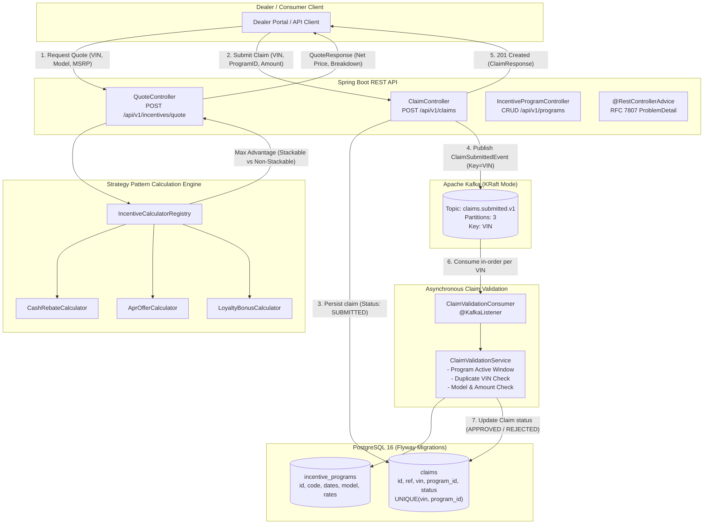

# ApexFlow — Automotive Telemetry & Incentive Arbitration Engine

An enterprise-grade OEM platform and dealer telemetry console for real-time incentive arbitration (Cash Rebates, APR financing subventions, Loyalty bonuses) and asynchronous claim clearinghouse processing via Apache Kafka and PostgreSQL.

---

## 1. Architecture & Workflow



---

## 2. Technology Stack

- **Java**: 17 (LTS)
- **Framework**: Spring Boot 3.3.x (Spring MVC, Spring Data JPA, Spring Kafka, Spring Validation)
- **Database**: PostgreSQL 16 with Flyway schema versioning
- **Message Broker**: Apache Kafka 3.8 in KRaft mode (No ZooKeeper required)
- **API Documentation**: OpenAPI 3 & Swagger UI (`springdoc-openapi`)
- **Testing**: JUnit 5, Mockito, AssertJ, Spring WebMvcTest, and Testcontainers (PostgreSQL 16)
- **Storage Strategy**: Configured for high-capacity secondary storage (`D:\` drive) ensuring zero footprint bloat on the host system drive.

---

## 3. Quickstart & Local Setup

### Step 1: Start Infrastructure (PostgreSQL & Kafka KRaft)
Ensure Docker Desktop is running, then execute:
```bash
docker compose up -d
```
Verify containers are healthy:
```bash
docker ps
```

### Step 2: Build & Run Tests
```bash
mvn clean test
```

### Step 3: Run Application Locally
```bash
mvn spring-boot:run
```
Interactive Swagger UI will be available at:
`http://localhost:8080/swagger-ui.html`

---

## 4. Ready-to-Test cURL Examples

### 1. Create an Incentive Program (Cash Rebate)
```bash
curl -X POST http://localhost:8080/api/v1/programs \
  -H "Content-Type: application/json" \
  -d '{
    "programCode": "FORD_SUMMER_CASH_2026",
    "name": "Summer $1,500 Customer Cash",
    "type": "CASH_REBATE",
    "vehicleModel": "F-150",
    "discountAmount": 1500.00,
    "stackable": true,
    "startDate": "2026-06-01",
    "endDate": "2026-12-31"
  }'
```

### 2. Create a Promotional APR Offer (Non-Stackable)
```bash
curl -X POST http://localhost:8080/api/v1/programs \
  -H "Content-Type: application/json" \
  -d '{
    "programCode": "FORD_APR_190_60M",
    "name": "1.9% Special APR Financing",
    "type": "APR_OFFER",
    "vehicleModel": "F-150",
    "aprRate": 1.90,
    "termMonths": 60,
    "standardAprRate": 6.50,
    "stackable": false,
    "startDate": "2026-06-01",
    "endDate": "2026-12-31"
  }'
```

### 3. Calculate an Incentive Quote
```bash
curl -X POST http://localhost:8080/api/v1/incentives/quote \
  -H "Content-Type: application/json" \
  -d '{
    "vin": "1FA6P8CF5H5123456",
    "vehicleModel": "F-150",
    "msrp": 52000.00,
    "existingOwner": true,
    "quoteDate": "2026-10-12"
  }'
```

### 4. Submit an Incentive Claim
```bash
curl -X POST http://localhost:8080/api/v1/claims \
  -H "Content-Type: application/json" \
  -d '{
    "vin": "1FA6P8CF5H5123456",
    "dealerId": "DLR-METRO-01",
    "programId": 1,
    "vehicleModel": "F-150",
    "msrp": 52000.00,
    "claimedAmount": 1500.00
  }'
```

### 5. Check Claim Audit & Approval Status
```bash
curl -X GET http://localhost:8080/api/v1/claims/1
```
